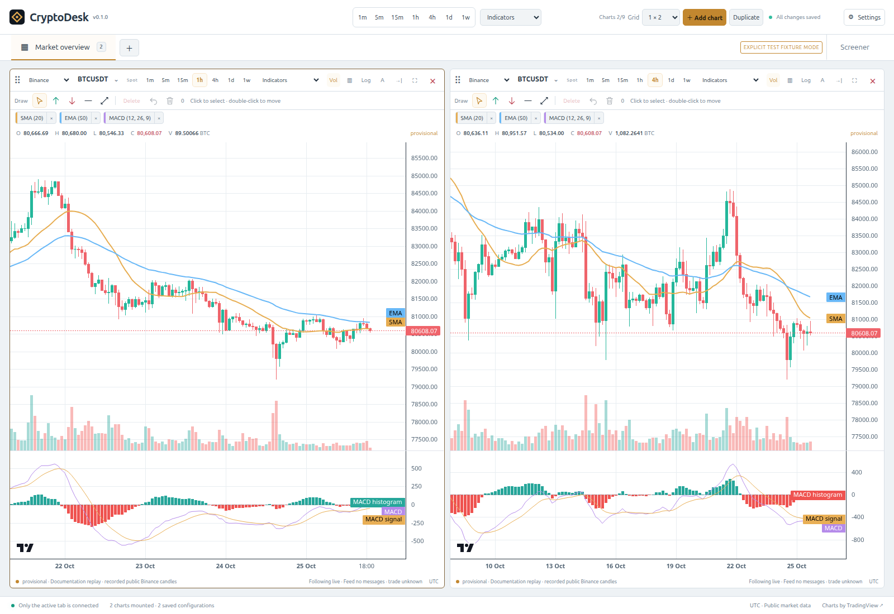
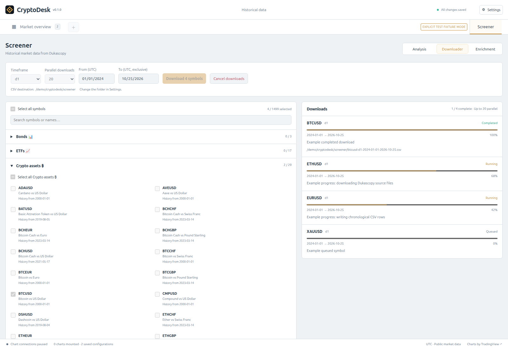
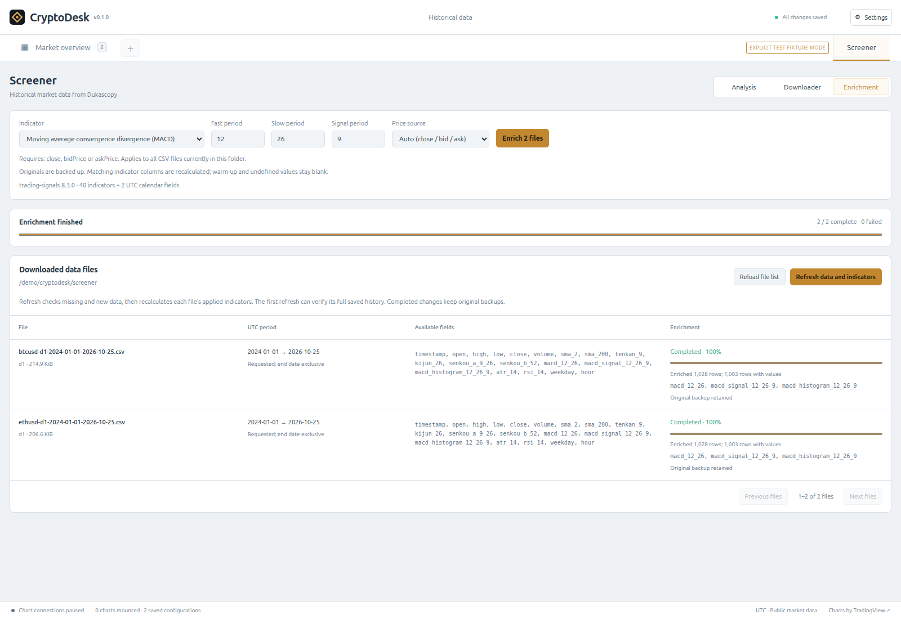
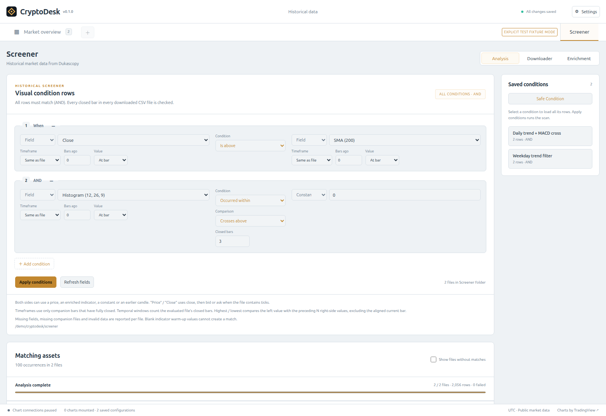
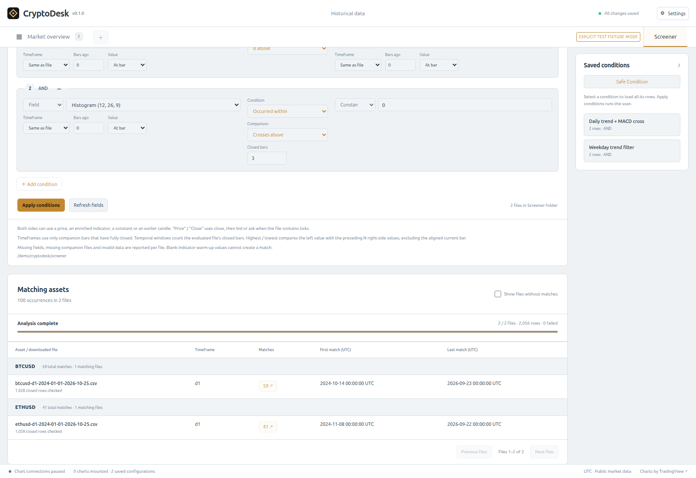
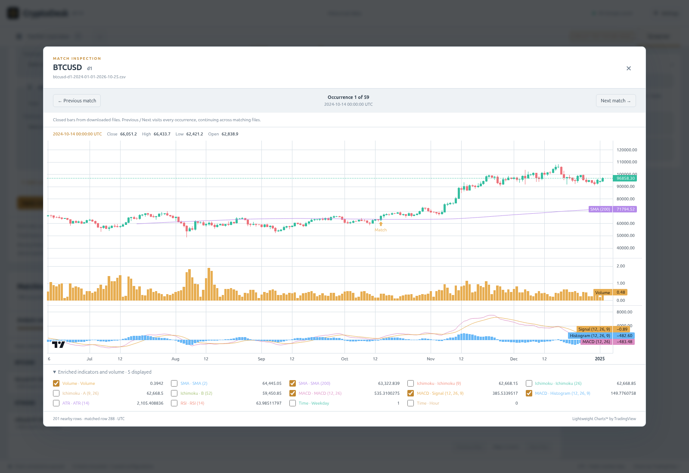

# CryptoDesk


**Live market charts and a visual historical Screener for Ubuntu and Windows.** Follow public spot and perpetual markets, download historical datasets, calculate indicators, and find the bars where your conditions matched—all from one desktop workspace.

[Download](#download) · [Charting features](#charting-features) · [Screener](#screener) · [Visual filters](#analysis-build-smart-filters-visually) · [Build from source](#build-from-source) · [Full user guide](APP_README.md)



*Independent 1-hour and 4-hour charts with SMA, EMA and resizable MACD panes. All screenshots use the light theme. They show the current UI in explicit documentation demo mode: chart candles were recorded from public Binance data, and Screener calculations use genuine Dukascopy histories. Downloader progress is illustrative. See [screenshot sources](docs/screenshots/README.md).*

- **A workspace that remembers your layout.** Up to 20 chart tabs and 9 charts per tab, with independent instruments, periods, indicators and drawings.
- **Public market data without an account.** Binance and Bybit spot/perpetual markets, plus Coinbase spot. No API keys required.
- **Historical downloads across asset classes.** Browse 1,499 Dukascopy instruments in 39 categories and download one symbol at a time with shared request pacing.
- **Reusable indicator data.** Enrich CSVs with 40 technical indicators plus UTC Weekday and Hour fields; refresh histories and recalculate applied indicators together.
- **Smart visual filters.** Compare prices, indicators, numbers and earlier bars; combine conditions, scan every closed historical bar, and inspect each match on a chart.
- **Local files and persistence.** SQLite workspace saving, export/import, resumable downloads, remembered Screener choices and named condition sets.

## Download

| Platform | Package in the [latest release](https://github.com/neodix42/charting/releases/latest) | Run |
|---|---|---|
| Ubuntu x64, system GTK/WebKit | `cryptodesk-X.Y.Z-linux-amd64.tar.gz` | Extract, then run `./cryptodesk` |
| Windows x64 | `cryptodesk-X.Y.Z-windows-amd64.zip` | Extract the whole ZIP, then run `cryptodesk.exe` |

[All releases](https://github.com/neodix42/charting/releases) · [Latest SHA-256 checksums](https://github.com/neodix42/charting/releases/latest/download/SHA256SUMS)

**Extract the complete archive.** Ubuntu and Windows packages include the private Node runtime, Dukascopy downloader, indicator library and browser support used by Screener. Keep `screener-runtime` alongside the application; no global Node/npm or runtime `npx` installation is needed.

The Windows ZIP includes a pinned WebView2 runtime. Keep `WebView2` and `portable.marker` beside the executable in a writable local folder; application data stays in its portable `data` folder. The executable is unsigned; native Windows GUI verification remains pending. See [Windows portable details](docs/WINDOWS_PORTABLE.md) and [installation instructions](APP_README.md#run-the-built-release).

### Linux runtime requirements

The small Linux archive requires **GTK3, WebKitGTK 4.1 and libsoup3 runtime libraries** installed on the system. GTK3 provides the native desktop window; WebKitGTK renders the interface and runs its JavaScript; libsoup3 and GLib networking provide the webview's HTTP/TLS support. The bundled Screener Chromium also uses NSS/NSPR, ALSA and X11 support libraries. Ubuntu's [WebKitGTK package](https://packages.ubuntu.com/noble/amd64/libwebkit2gtk-4.1-0) installs its dependent libraries automatically.

On **Ubuntu Desktop 24.04 or 26.04 x64**, install the runtime dependencies once:

```bash
sudo apt update
sudo apt install -y \
  libgtk-3-0t64 libwebkit2gtk-4.1-0 libsoup-3.0-0 \
  glib-networking gsettings-desktop-schemas dconf-gsettings-backend \
  ca-certificates fonts-dejavu-core \
  libnss3 libnspr4 libasound2t64 libxss1
```

These are runtime packages; Go, a compiler and the `-dev` packages are needed only when building from source. Run CryptoDesk from a graphical desktop session with working graphics drivers. GitHub releases build on Ubuntu 24.04 x64; older systems require separate verification, and local builds inherit their build host's glibc requirement. The Linux archive includes optional `install-user.sh` for application-menu and desktop shortcuts. Linux releases use the system GTK/WebKit libraries; the separate bundled GTK/WebKit archive is retired.

## Charting features

First launch opens **one tab with one chart**. New tabs also start with one chart; larger grids add empty slots for you to fill. Later launches restore your actual saved workspace.

- **Independent charts:** choose exchange, spot/perpetual instrument and period per chart. Chart intervals are **1m, 5m, 15m, 1h, 4h, 1d and 1w**. Binance USD-M/COIN-M and Bybit linear/inverse perpetuals are supported; Coinbase supplies spot markets.
- **Indicators and drawings:** SMA, EMA, Ichimoku Cloud and MACD, with editable parameters, colors and multiple instances. Adjust moving-average widths and resize MACD panes. Add arrows, horizontal levels and trend lines; select, move or remove drawings.
- **Flexible layouts:** drag tabs/charts, resize grid tracks, maximize a chart, rename tabs and duplicate layouts. Shared period and indicator controls apply to the current tab's charts.
- **Display controls:** Dark, Light, Matrix (black/lime), Cyberpunk and Red Sands themes, global font size, display timezone, candlestick/line rendering, volume, linear/log scales, saved viewports and configurable right-side chart space. **Settings → Appearance → Theme** updates the interface, opened dropdown menus and chart colors immediately and remembers your choice. **Font size** scales interface text and chart labels from **10–24 px** (default **15**).
- **Automatic saving:** SQLite persistence, JSON workspace export/import and recovery snapshots. Optional local candle storage reuses genuine downloaded chart history across restarts.
- **Efficient live feeds:** only the active chart tab renders and subscribes. Opening Screener saves chart views and releases live chart subscriptions; returning restores the selected tab. Connection and provisional-data states remain visible.

Useful shortcuts: **Ctrl+T** adds a tab, **Ctrl+Shift+N** adds a chart, **Ctrl+Tab / Ctrl+Shift+Tab** switches tabs, and **Ctrl+W** confirms closing the active tab. CryptoDesk reads public market data and does not place trades or connect to exchange accounts.

Settings are grouped into **Appearance**, **Storage**, **Screener**, **Export** and **Debug** tabs. Appearance controls theme, text size, timezone and chart spacing; Storage controls the local chart-candle cache; Screener sets the CSV folder; Export contains workspace import/export/reset; Debug contains resource and backend diagnostics. Light uses a blue accent; switching themes repaints action buttons, progress bars, candles and volume immediately.

## Screener

The fixed **Screener** tab sits at the far right of the chart-tab row. Its three screens form one workflow:

| Screen | What you do | What you get |
|---|---|---|
| **Downloader** | Select symbols, timeframe and dates | Local historical CSV files |
| **Enrichment** | Choose indicators and parameters | New columns in those same CSV files |
| **Analysis** | Build and apply visual conditions | Matching assets, occurrence counts and charts of each match |

Chart feeds come from Binance, Bybit and Coinbase. Screener histories come from **Dukascopy** and use its instrument names and available history. Once downloaded, enrichment and analysis run locally against those files.

### Downloader: choose symbols and collect history



*Select individual instruments, whole categories or the complete catalog. Each queued symbol has its own status and progress; the progress rows pictured here are examples.*

1. Open **Screener → Downloader**. Search or expand categories such as crypto assets, forex, commodities, indices, stocks, ETFs and bonds.
2. Select the instruments you want—for example, **BTCUSD** and **ETHUSD**.
3. Choose one common timeframe and UTC date range. **From** is inclusive; **To** is exclusive. Available history depends on the instrument.
4. Press **Download**. Symbols download sequentially, with one active data request at a time. Additional symbols wait in the queue; progress, completed paths and provider errors appear per symbol.

Downloader and **Refresh data and indicators** each process **one asset at a time**. Their shared request queue allows only **one active data request**, including browser verification, and spaces request starts at least **two seconds apart**. This is CryptoDesk's conservative default, not a published Dukascopy quota. HTTP **429** pauses the queue using `Retry-After` or exponential backoff. Wait reasons appear in each job's status, and cooldowns survive app restart.

An HTTP **403** is an access refusal, and does not establish that a rate limit was exceeded. CryptoDesk stops requests and records a **15-minute access-denial cooldown**, extended if the provider asks for longer. The error shows when to retry manually; restarting or clicking Resume during the cooldown sends no new request. Existing CSVs and committed checkpoints are retained. If access is still refused after the cooldown, use [Dukascopy support](https://www.dukascopy.bank/contact/); reducing the rate cannot guarantee that a WAF refusal will clear. The upstream library also treats [rate limits separately from browser verification](https://github.com/Leo4815162342/dukascopy-node/blob/master/src/buffer-fetcher/rate-limit.ts).

**Select all downloaded assets** replaces the selection with symbols that already have CSV files in the current Screener folder, across all date ranges and timeframes. Search and collapsed categories do not limit it. Files from earlier sessions count; removed files and unfinished downloads do not.

**Download** maintains **one CSV per symbol and timeframe** and fetches **only missing ranges**. An earlier **From** prepends history; a later **To** appends it. Already covered ranges need no download, and narrowing the selection never removes saved bars. The filename expands to cover the earliest saved/requested start and latest saved/requested end, including actual CSV timestamps. Applied indicators are recalculated over the combined history so earlier data supplies the correct warm-up context.

**To** remains exclusive. Selecting tomorrow UTC downloads the latest available data through the time the batch starts, including a current partial candle. Partial candles may be fetched again until closed. Downloaded ranges and their checkpoints survive restart, including separate earlier/later ranges. Older overlapping or separate files for the same symbol/timeframe are merged into one history; the superseded CSVs are removed from the main folder after safe publication, with exact originals retained in hidden backups. Dukascopy source files can span larger time buckets, but only missing requested rows are merged.

The Downloads panel shows **10 jobs per page**, with totals for **completed** and **failed** downloads. Its status filter includes **Failed** and **Completed**; **All statuses** includes completed jobs alongside queued, running and other jobs. Filtering happens before pagination.

The pinned [dukascopy-node](https://github.com/Leo4815162342/dukascopy-node) integration supports **1,499 instruments across 39 categories** and ten timeframes: **tick, s1, m1, m5, m15, m30, h1, h4, d1 and mn1**. Choose `d1` for daily indicator research or an intraday interval for hour-based conditions.

Downloads continue when you switch screens. **Closing the app pauses unfinished downloads; the next launch resumes them automatically from committed batches.** Symbol selection, timeframe, dates and category open/closed states are remembered. Older saved parallel-download choices and queued downloads are restored sequentially. Completed files are retained. **Cancel downloads** discards unfinished work and stops automatic continuation; **Resume downloads** can retry failed or paused jobs.

Use **Settings → Screener → Screener download folder** to change the destination. The default on Linux is `~/.local/share/cryptodesk/screener`; Windows portable builds use `data/screener`. Changing the setting does not move previous files. Network/provider failures are reported visibly. If the bundled downloader is unavailable, the screen reports the runtime error and offers **Retry downloader**; restore the complete release archive before retrying.

### Enrichment: turn histories into indicator datasets



*The file list shows each dataset's timeframe, actual UTC timestamps from its first and last rows, and comma-separated fields. MACD adds its line, signal and histogram columns while retaining existing prices and indicators.*

1. Open **Screener → Enrichment** to inspect downloaded files and their available fields.
2. Choose an indicator, its parameters and, where applicable, a price source.
3. Press **Enrich** to calculate it for **all CSV files in the folder**, including files on other list pages. Overall and per-file progress show completion or errors.
4. Repeat for the indicators you want to compare in Analysis.

The file list uses **20 rows per page**. Enrich and Refresh process all applicable files across every page. **Enrich** calculates local indicators using up to **20 parallel file workers**, without making provider requests. **Refresh** processes **one asset at a time**, completing its download and indicator recalculation before starting the next. Overall and per-file progress show completed, active and queued work.

The bundled [trading-signals](https://github.com/bennycode/trading-signals) integration provides **40 technical indicators** across moving averages, momentum, trend, volatility and volume. Examples include SMA/EMA, RSI, MACD, Ichimoku/Tenkan/Kijun, ATR, Bollinger bands, Donchian channels, stochastic oscillators, ADX, OBV and VWAP.

Readable column names include `sma_200`, `tenkan_9`, `kijun_26`, `rsi_14`, `atr_14`, `macd_signal_12_26_9` and `macd_histogram_12_26_9`. Repeating an indicator replaces its matching columns; other fields remain intact. Initial warm-up values stay empty—for example, a 200-period SMA needs sufficient earlier rows before it can participate in a match.

The **Time** category adds **Weekday** (`weekday`, Monday **1** through Sunday **7**) and **Hour** (`hour`, **0–23**). Both use the original timestamp in **UTC**, take no parameters and need no warm-up. Candle timestamps describe the bar's opening time, so daily files normally have Hour `0`; use intraday data for hour-of-day filters.

The two file actions have different purposes:

| Action | Behavior |
|---|---|
| **Reload file list** | Discover and display files and headers without downloading or recalculating data. |
| **Refresh data and indicators** | Download missing/new history, repair gaps, revise overlapping source values, append fully closed bars, and recalculate every applied indicator using its saved parameters. |

Enrich and Refresh first consolidate legacy files for each symbol/timeframe locally, preserving all saved bars and recalculating the combined indicator columns. Refresh then downloads through the instant you clicked and recalculates indicators over the updated history. A subsequent provider error, including HTTP 403, leaves the consolidated file available. New candles must be fully closed at the shared cutoff; ticks are included up to it. **UTC period** follows the actual most recent CSV row, while the filename expands to the updated date range. Progress and file lists follow the new filename. Market closures and provider availability can leave the last row earlier than the cutoff.

Refresh verifies histories without a trusted coverage fingerprint from their earliest saved/requested start through that cutoff; verified files use recent overlap and new data. History publication keeps a recovery journal and exact originals in `.cryptodesk-history-publications`; individual enrichment backups remain in `.cryptodesk-enrichment-backups`. Unknown derived columns or missing inputs produce per-file errors while preserving originals. Completed changes survive restart; interrupted **enrichment or refresh must be run again**. See the [full enrichment guide](APP_README.md#enrichment) for backup locations, source selection and recovery details.

### Analysis: build smart filters visually

**Visual condition rows** let you express a research rule without writing code. Choose a left value, an operator and a right value. Add rows with **+ Add condition**, remove them with **−**, and combine them with **AND**: every row must hold at the evaluated bar.

Hover an operator control or its **?** help button for its description and an example. The help button also works with keyboard focus, including for comparisons inside temporal rules.



*Example: Close is above SMA(200), and the MACD histogram crossed above zero within the last three closed bars. Named condition sets are available in the right sidebar.*

Both sides can use:

- **Prices or fields:** Close/Price, Open, High, Low, volume or an enriched indicator already present in the file.
- **Constants:** enter a number such as `0`, `40` or `60`.
- **Earlier bars:** set **Bars ago** to `1` for the preceding closed bar, `2` for two bars earlier, and so on. `0` refers to the latest fully closed bar available at the historical point being checked.
- **Other timeframes:** use **Same as file**, or select an available companion timeframe for the same asset. Download and enrich those companion files first.
- **Window values:** use the optional highest/lowest aggregation to compare against a range of earlier values.

Timeframe alignment uses only bars that had **fully closed** at the point being evaluated. For example, an intraday rule can use the last closed daily indicator without reading the future daily close.

| Operator | Example rule |
|---|---|
| **Is above / Is below** | Close is above SMA(200), or Kijun is below Tenkan. |
| **Is equal** | Weekday is equal to `1` (Monday), or Close is equal to Open. |
| **Crosses above / Crosses below** | Tenkan crosses above Kijun, comparing the preceding and current closed bars. |
| **Is between** | RSI is between `40` and `60`, including both boundaries. |
| **Is within a distance** | Close is within `0.2 × ATR(14)` of SMA(200). |
| **Occurred within** | A MACD histogram cross above `0` occurred within the last `3` closed bars. |
| **Remained true for** | Close remained above SMA(200) for `5` closed bars. |
| **Highest in window / Lowest in window** | Close exceeds the previous `20`-bar High, or falls below the previous `20`-bar Low. The current bar is excluded from the reference window. |

**Is equal** compares numeric values exactly, with no rounding or tolerance. It supports indicators, prices, constants and earlier bars, including inside **Occurred within** and **Remained true for**. Use **Is within a distance** for approximate equality. Missing values and indicator warm-up blanks never match.

**Try the filter shown above:**

1. Download daily BTCUSD and ETHUSD histories with enough bars for SMA(200), then enrich them with **SMA**, period `200`, and **MACD**, fast `12`, slow `26`, signal `9`.
2. In Analysis, set the first row to **Close → Is above → SMA (200)**.
3. Add a second row: **Histogram (12, 26, 9) → Occurred within → Constant 0**. Set **Comparison** to **Crosses above** and **Closed bars** to `3`.
4. Leave both timeframes at **Same as file** and **Bars ago** at `0`, then press **Apply conditions**.

Below **Apply conditions**, **Asset categories to scan** lists the same categories as Downloader. All categories start enabled. Use individual checkboxes, **Select all** or **Deselect all** to choose the scan scope. Only downloaded files in the selected categories are evaluated; the selection is retained in the draft and saved condition sets.

You can also enrich Weekday/Hour and add rows such as **Weekday is between 1 and 5** or **Hour is between 8 and 16** for UTC calendar filters.

#### Save and reuse a condition set

Press **Safe Condition** in the right-hand **Saved conditions** panel, then enter a name. It saves the entire set of rows, including operands, operators, parameters, timeframes, offsets and windows.

Click a saved name to load its rows into the editor. You can adjust the working copy, then press **Apply conditions** to scan; loading a set does not run it automatically. Named sets and the current draft survive restart. Save an edited version under a new name to retain the original snapshot. These settings are stored locally, separately from chart workspace exports.

Right-click an entry in **Saved conditions** and choose **Delete** to permanently remove that saved set. The list updates after deletion succeeds, and the change persists across restarts. The current working rules remain available on the left. Keyboard users can focus an entry and press **Shift+F10** to open the same menu.

#### Apply, inspect and navigate matches

**Apply conditions** checks **every closed historical bar in downloaded files from the selected categories**. The results list groups occurrences by asset/file and timeframe, showing the asset's full catalog description, match count and first/last occurrence. Progress and per-file errors remain visible. Blank warm-up values cannot match; missing fields or companion histories are reported. Completed files without matches are hidden; per-file failures remain visible.

Analysis reads CSVs without modifying them. Identical legacy datasets for the same asset/timeframe produce **one result and one set of occurrences**; legacy files with different ranges can still appear separately until the next **Refresh**, **Enrich** or **Download** consolidates them. Different timeframes remain separate histories.

Matching assets uses **10 file records per page**. The **Asset category** filter narrows displayed results before pagination; it does not change or rerun the scan. For example, an ARKIUSUSD group displays **ARK Artificial Intelligence & Robotics UCITS ETF** beside its symbol.



*This particular daily-history example produced 100 occurrences: 59 in BTCUSD and 41 in ETHUSD. These are historical matches for the pictured data and rule, not current signals.*

Click a result row to open the chart around its match. The popup displays candles or tick prices, a match marker and the available enriched indicators. Use the field checkboxes to choose overlays and oscillator panes; hover to inspect values. **Previous match** and **Next match** move between occurrences, including adjacent result files.



*Inspect the surrounding bars and indicator values rather than only a match count. The occurrence counter shows your position in the file's matches.*

Analysis is an on-demand historical scan. It does not run live alerts or calculate strategy profit/loss. After refreshing or changing a dataset, press **Apply conditions** again to rebuild results; stale match charts are rejected. Results are paginated without dropping occurrences.

### How Screener works

1. **Download:** the Go download manager queues symbols and runs the pinned Dukascopy worker. It writes chronological CSVs and saves committed batches for restart recovery.
2. **Enrich:** local indicator workers read those CSVs, calculate fields in chronological order, preserve exact backups and publish completed files. Applied recipes retain the parameters needed for later refreshes.
3. **Refresh:** source history is merged with existing data, then indicator recipes are recalculated over the updated history, including the context needed by recursive indicators.
4. **Analyse:** the engine indexes local numeric data and evaluates the AND rule at each closed bar, aligning companion timeframes without future lookahead. Disk-backed indexes and bounded caches keep large scans from requiring all histories in memory.
5. **Inspect:** paginated match indexes supply occurrence counts and bounded chart windows. Rule drafts and named sets persist; scan results are rebuilt when requested.

See the [complete Screener guide](APP_README.md#screener) for file formats, checkpoints, backups, limits and error handling.

## Build from source

CryptoDesk uses **Go + Wails v2 + React/TypeScript + Lightweight Charts v5 + SQLite**. Requires Go, Python 3.12+, and a C compiler/pkg-config for Linux. Linux builds need the GTK3 and WebKitGTK 4.1 development packages; Windows packaging on Ubuntu needs `7z`. Scripts use pinned project-local Wails and bootstrap a verified local Node/npm bundle if a usable toolchain is absent. They do not install OS packages or change your shell configuration.

```bash
./build.sh                 # Linux executable, standard archive and checksums in the root
./win-build.sh             # Windows x64 portable ZIP, including English WebView2
```

`VERSION` provides the source baseline. Release builds pass `CRYPTODESK_VERSION=X.Y.Z` so packages and manifests carry the release version. Full prerequisites and development instructions are in [APP_README.md](APP_README.md#build-and-develop).

## Automatic releases

The [release workflow](.github/workflows/release.yml) runs on pushes to `main`. It runs checks, builds the standard Linux archive and Windows ZIP, and publishes only after both packages pass verification. It increments the highest release tag's patch version, starting at `v0.1.0` when no release exists. Builds do not create source-version bump commits.

Release jobs are serialized; reruns recognize published commits, and stale workflow revisions are prevented from publishing. Packages, checksums and `release.json` use versioned filenames. Actual local verification and remaining platform checks are documented in [STATUS.md](STATUS.md).

## Development and verification

```bash
scripts/test.sh                         # Python, Go race/vet, frontend checks and build
cd frontend && npm run test:e2e          # Browser tests with an explicit fixture bridge
# From the repository root:
scripts/smoke-desktop.sh                # Actual Wails/WebKit app, isolated test workspace
go run ./cmd/smoke -duration 65s         # Separate public-exchange live checks
```

Normal builds contain no fixture bridge. Browser tests, documentation screenshots, native desktop checks and live exchange checks are separate evidence; [STATUS.md](STATUS.md) records what has actually passed. See [desktop smoke instructions](docs/DESKTOP_SMOKE.md) and the [screenshot provenance](docs/screenshots/README.md).

The original specification bundle remains at the repository root: [START_HERE.md](START_HERE.md), [SPEC.md](SPEC.md), [IMPLEMENTATION_PLAN.md](IMPLEMENTATION_PLAN.md) and [TEST_PLAN.md](TEST_PLAN.md). Design changes are recorded in [DECISIONS.md](DECISIONS.md).

## License and attribution

CryptoDesk is licensed under [Apache 2.0](LICENSE). Charts use [TradingView Lightweight Charts](https://www.tradingview.com/lightweight-charts/). Screener integrates [dukascopy-node](https://github.com/Leo4815162342/dukascopy-node) and [trading-signals](https://github.com/bennycode/trading-signals). Dependency notices and redistributed licenses are included in [docs/THIRD_PARTY_NOTICES.md](docs/THIRD_PARTY_NOTICES.md) and the release packages. Windows packages also include Microsoft's WebView2 redistribution terms.
